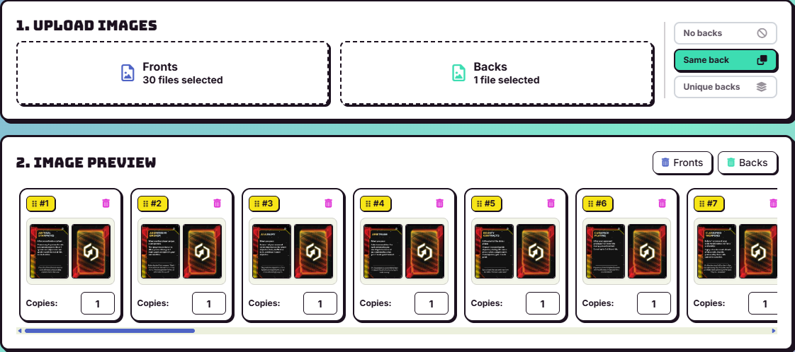

# Discordant Stars — Print-and-Play Guide by a fan

A guide written aiming to simplyfy the process of printing a playable version of the the fan-made [Discordant
Stars](https://twilight-imperium.fandom.com/wiki/Discordant_Stars_Expansion_(UNOFFICIAL)) expansion for [Twilight Imperium: Fourth Edition](https://www.fantasyflightgames.com/productline/twilight-imperium-fourth-edition/).

## Premise and disclaimer

Discordant Stars is an **unofficial**, non-commercial **fan project**. It is not
published, endorsed, sponsored, or otherwise affiliated with Asmodee, Fantasy
Flight Games, or the creators of *Twilight Imperium*. *Twilight Imperium* and
its associated names, logos, artwork, and intellectual property belong to
their respective rights holders. The files and instructions in this repository are provided for personal,
non-commercial use only.
They must not be sold, bundled into a commercial product, or presented as
official material. Please do not redistribute source files or artwork outside
the channels and terms established by the original creators. Always check the
current license, community guidelines, and distribution instructions supplied
with the source files before sharing or printing them.
Futhermore this guide is made by an independent fan and it is not related to the actual creators of the expansion. Learn more on the dedicated [wiki](https://twilight-imperium.fandom.com/wiki/Discordant_Stars_Expansion_(UNOFFICIAL))

AI has been used to help for the creation of this project.

If you believe that material in this guide has been used improperly, or that a
credit is missing, please contact me so it can be corrected.

## Table of Contents

[Before You Begin](#before-you-begin)
   [Introduction](#introduction)
   [Copyright and Community Disclaimer](#copyright-and-community-disclaimer)
[Use of Artificial Intelligence](#use-of-artificial-intelligence)
[Preparing the Files](#preparing-the-files)
   [Sources](#sources)
   [Uncharted Space](#uncharted-space)
   [Adapting the Files Using the Script](#adapting-the-files-using-the-script)
 [Printing](#printing)
   [Choosing the Materials](#choosing-the-materials)
   [Printing the Components](#printing-the-components)
   [Tools Needed](#tools-needed)

## Obtaining printable files

### Step 1: Download

The latest discordant files source files can be found in the [official Google drive folder](https://drive.google.com/drive/folders/1AipLLvGhyp2v--w2oeT7uQIovmH_HyVn).The most updated version of all the files will always be stored there. 

If you want you can directly download all the files (already converted into printable PDFs) from the [releases section](https://github.com/OrsolonLudovico/Discordant_stars_PNP/releases/) but **THEY HAVE SOME ISSUES**, mainly the back of some cards is upside down with respect to the front (this doesn't affect gameplay but it's not the correct way to do it). Also some assets are a little bit blurry (nothing too severe). You can learn how to prepare your own layout by reading this guide but if you choose to use those files you can jump directly to [Printing](#printing).

### Step 2: Fix the images

- Some images will be not vertical and they must be rotates, to do that **DO NOT** use *right click > rotate* because it will only apparently work, you need to rotate the actual pixels, you can use the [python script](Scripts/rotate.py) provided in this repo.

- In the drive images are provided in *PNG* which uses a relatively high amount of storage space and also often makes the application used to build the layout crash due to the large size. Converting to *jpg*/*jpeg* decreases the size of the files significantly enabling the layout application to crash considerably less, converting to *jpg*/*jpeg* (even with 100% quality) may still lead to a small increase in the image overall "blurryness". To convert a folder to *jpeg* in the correct way you can use the provided [python script](Scripts/convert%20to%20jpeg.py).

- Twilight Imperium cards are exactly $4.20 \times 6.40$ cm this means that the proportion is $ 4.2 \div 6.4 = \frac{21}{32}$. Some images are $\frac{1}{24} = 2 \times \frac{1}{48}$, to remove the excess $\frac{1}{24}$ from both sides you can uses the provided [python script](Scripts/tighten%201%20out%20of%2024.py).

### Step 3: Build the layout

To build the layout I used the [layout tool from pnpbuddy](https://pnpbuddy.com/layout/) which is a free online tool with no dowload or account requirement; this guide will use that website as reference.

#### 3.1 Uploading images

Just upload all the fronts and the backs in the dedicated sections, if you put the same number of fronts and backs the application will recognize that every front has a different back, if you put just one back the application will recognize that you want all the fronts to have the same back. You'll have a preview below the buttons.

  
  

### Step 1: download

### Step 1: download

### Step x: What about the exagon tiles?

#### Uncharted Space

**Uncharted Space** is a stand alone expansion that adds new systems along side new exploration and action cards; it is included inside the 
broad Discordant stars expansion in the [dedicated folder](https://drive.google.com/drive/folders/1XAE7tO037fEPtYUDFTCLNXh8tp_fmXJU) on the drive.  Generally the files present in this folder are easier to handle than the rest and require less human intervention.

### Adapting the Files Using the Script

The `Scripts` folder contains small utilities for common preparation tasks,
including rotation, image conversion, and tightening the layout. The scripts
are:

- `rotate.py` — rotates source images when their orientation needs correcting;
- `convert to jpeg.py` — converts compatible source images to JPEG;
- `tighten 1 out of 24.py` — applies the project's layout-tightening workflow.

Run scripts on a duplicate of the source files and inspect the output before
printing. Keep the original resolution whenever possible, verify that text
and bleed areas are intact, and confirm the final page dimensions in a PDF or
image viewer. Script parameters and expected input formats may change as the
project evolves, so read the script before using it.

## Printing

250 mg/m2, controlla lelasticità controlla il colore e schiarisci

### Choosing the Materials

Choose materials based on the component type, the finish you want, and the
equipment available. In general:

- use heavier paper or cardstock for cards, player aids, and reference sheets;
- use adhesive paper or mounting board when components need extra rigidity;
- use a matte finish when readability and reduced glare are more important than
  photographic color;
- use sleeves when you want to protect printed cards or combine them with
  cards from the base game.

Always make a small test print first. Check the scale against a base-game
component before committing to the complete set.

### Printing the Components

Print at **100% scale** or use the document's actual-size setting. Disable
options such as “Fit to page” unless the source specifically requires them.
Print one representative page first and verify:

1. the page size and orientation;
2. the front-to-back alignment;
3. the colors and legibility;
4. the cut lines, margins, and bleed.

After printing, allow ink to dry fully before cutting, mounting, or sleeving
the components. Store finished pieces by component type and label any
unfinished batches to avoid mixing versions.

### Cutting the components

#### Tools Needed

The exact setup depends on the chosen production method. A useful basic kit
includes:

- a printer or access to a professional print service;
- a ruler and pencil for checking scale and marking cuts;
- a sharp craft knife or paper trimmer;
- a cutting mat;
- scissors for rough cuts;
- adhesive, sleeves, or mounting board as required by the chosen materials;
- a flat surface and weights for mounting components cleanly.

Work carefully with sharp tools and adhesives, and follow the safety
instructions supplied with the equipment.
