# Discordant Stars — a Print-and-Play Guide by a fan

A guide written to simplify the process of printing a playable version of the fan-made [Discordant
Stars](https://twilight-imperium.fandom.com/wiki/Discordant_Stars_Expansion_(UNOFFICIAL)) expansion for [Twilight Imperium: Fourth Edition](https://www.fantasyflightgames.com/productline/twilight-imperium-fourth-edition/).

## Premise and disclaimer

Discordant Stars is an **unofficial**, non-commercial **fan project**. It is not published, endorsed, sponsored, or otherwise affiliated with Asmodee, Fantasy Flight Games, or the creators of *Twilight Imperium*. *Twilight Imperium* and its associated names, logos, artwork, and intellectual property belong to their respective rights holders. The files and instructions in this repository are provided for personal, non-commercial use only. They must not be sold, bundled into a commercial product, or presented as official material. Please do not redistribute source files or artwork outside the channels and terms established by the original creators. Always check the current license, community guidelines, and distribution instructions supplied
with the source files before sharing or printing them. Furthermore, this guide was made by an independent fan and is not related to the actual creators of the expansion. Learn more on the dedicated [wiki](https://twilight-imperium.fandom.com/wiki/Discordant_Stars_Expansion_(UNOFFICIAL))

AI was used to help create this project.

If you believe that material in this guide has been used improperly, or that a credit is missing, please contact me so it can be corrected.

## Table of Contents

- [Premise and disclaimer](#premise-and-disclaimer)
- [Obtaining printable files](#obtaining-printable-files)
  - [Step 1: Download](#step-1-download)
  - [Step 2: Fix the images](#step-2-fix-the-images)
  - [Step 3: Building the cards layout](#step-3-building-the-cards-layout)
    - [3.1 Uploading images](#31-uploading-images)
    - [3.2 Layout settings](#32-layout-settings)
    - [3.3 Inspecting the PDF](#33-inspecting-the-pdf)
  - [Step 4: Building the Hexagon layout](#step-4-building-the-hexagon-layout)
    - [4.1 Create the Layout](#41-create-the-layout)
    - [4.2 Populate the layout](#42-populate-the-layout)
    - [4.3 Export the Layout](#43-export-the-layout)
  - [Step 5: Building the tokens Layout](#step-5-building-the-tokens-layout)
- [Printing and cutting](#printing-and-cutting)
  - [How can I print them? Which materials should I use?](#how-can-i-print-them-which-materials-should-i-use)
  - [Printing the Components](#printing-the-components)
  - [Cutting the components](#cutting-the-components)
    - [Tools Needed](#tools-needed)
    - [Cutting](#cutting)
    - [System tiles and tokens](#system-tiles-and-tokens)
    - [Refining the angles](#refining-the-angles)
    - [Results](#results)
- [Cover and box](#cover-and-box)
- [3D printed insert](#3d-printed-insert)
- [Time and money spent on this project](#time-and-money-spent-on-this-project)

## Obtaining printable files

### Step 1: Download

The latest Discordant Stars source files can be found in the [official Google Drive folder](https://drive.google.com/drive/folders/1AipLLvGhyp2v--w2oeT7uQIovmH_HyVn). The most up-to-date version of all the files will always be stored there.

If you want, you can directly download all the files (already converted into printable PDFs) from the [releases section](https://github.com/OrsolonLudovico/Discordant_stars_PNP/releases/), but THEY HAVE **SOME ISSUES**:
- The back of some cards is upside down with respect to the front (this doesn't affect gameplay but it's not the correct way to do it).

- Some assets are a little bit blurry (nothing too severe). 

- The faction sheets have some ugly angles.

You can learn how to prepare your own layout by reading this guide, but if you choose to use those files, you can jump directly to [Printing](#printing-and-cutting).

### Step 2: Fix the images

- Some images may not be vertical and must be rotated. To do that, **DO NOT** use `right click > rotate`, because it will only appear to work; you need to rotate the actual pixels. You can use the [Python script](Scripts/rotate.py) provided in this repo.

- In the Drive, images are provided in *PNG*, which uses a relatively large amount of storage space and often makes the application used to build the layout crash because of the file size. Converting to *JPG*/*JPEG* significantly decreases the file sizes and makes the layout application less likely to crash. However, converting to *JPG*/*JPEG* (even at 100% quality) may still lead to a slight increase in the overall image "blurriness". To convert a folder to *JPEG* correctly, you can use the provided [Python script](Scripts/convert%20to%20jpeg.py).

- Twilight Imperium cards are exactly $4.20 \times 6.40$ cm. This means that the proportion is $4.2 \div 6.4 = \frac{21}{32}$ . Some images are $\frac{1}{24} = 2 \times \frac{1}{48}$ . To remove the excess $\frac{1}{24}$ from both sides, you can use the provided [Python script](Scripts/tighten%201%20out%20of%2024.py).

### Step 3: Building the cards layout

To build the layout, I used the [layout tool from pnpbuddy](https://pnpbuddy.com/layout/), which is a free online tool with no download or account requirement; this guide will use that website as a reference.

#### 3.1 Uploading images

Just upload all the fronts and backs in the dedicated sections. If you upload the same number of fronts and backs, the application will recognize that every front has a different back; if you upload just one back, the application will recognize that you want all the fronts to have the same back. You'll have a preview below the buttons. **WARNING:** As mentioned before, too many pictures or pictures that are too large may crash the application. Try [converting to *JPEG*](#step-2-fix-the-images) or use fewer images at a time.

  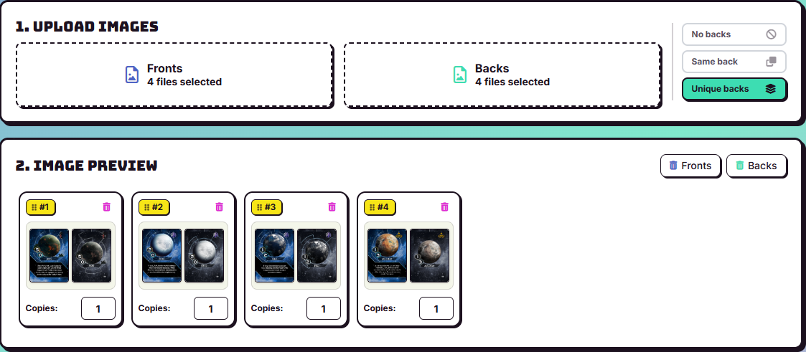
  

#### 3.2 Layout settings

Now you have to choose the settings:

- **PAPER SIZE** can be whatever you want. A4 will be the easiest, but it doesn't matter: the tool will automatically fit as many cards as it can on whatever size you choose. The orientation is also not important, so choose whichever you prefer.

- As mentioned before, **CARD SIZE** is $4.20 \times 6.40$ cm, so you should use *width = 42* and *height = 64*. If you're working on the faction sheets, you should enter their measurements, which are $19.00 \times 27.90$ cm. Also experiment with the page orientation if you get an error.

- The **BLEED** is the amount of the images that should be outside the actual cards, in every image provided there is some bleed. For the cards in the [Uncharted Space folder](https://drive.google.com/drive/folders/1XAE7tO037fEPtYUDFTCLNXh8tp_fmXJU) and the faction sheets the bleed is *3mm* while for the rest of the cards the bleed is usually around *3.8mm* (the folders differ a bit). You should experiment, look at the results and figure out if the actual cards contain the images correctly.

- The **CROSSHAIR** is the guide that will help you cut the cards once printed. You can use whichever parameters you prefer, but be careful: if the crosshair is too large, part of it may be left on the card when you cut it. I used a *width* of 0.1 and a *Size* of 3, as shown in the picture.

- The **BORDERS** should always have *width 1*: they determine how much space there is between cards. You'll need a bit of space, but too much means wasting paper. The radius is mostly fine at *3mm* (*Size "S"*), but **BE CAREFUL**: you need to remove the radius completely when working on the faction sheets, or you'll have ugly angles. The color can be whatever you want, but black helps if you cut inaccurately because it usually doesn't stand out.

  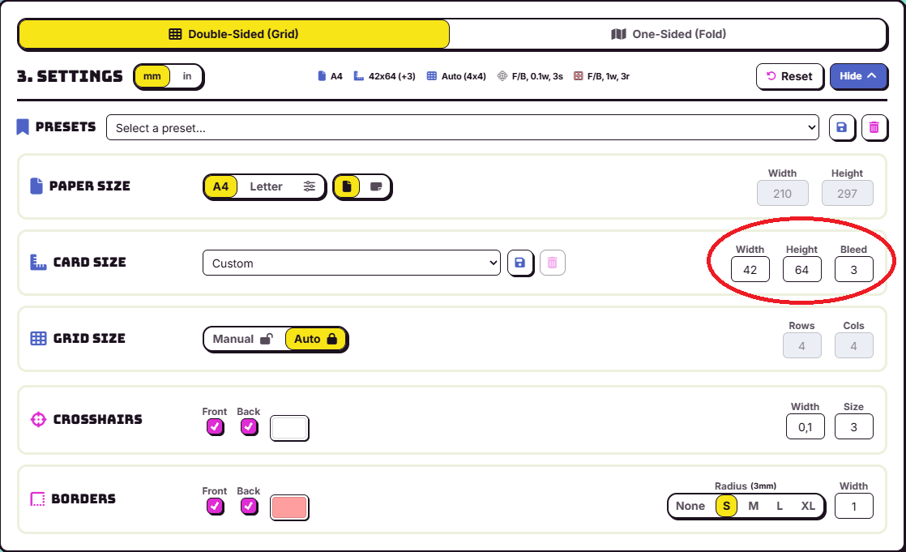

After adjusting the settings, you can download the *PDF* by pressing the "Generate PDF" button.

#### 3.3 Inspecting the PDF

Once you have downloaded the PDF, you should check that it has the correct real-world dimensions ($4.20 \times 6.40$ cm for standard cards; see the image) and that the PDF is set to A4.

  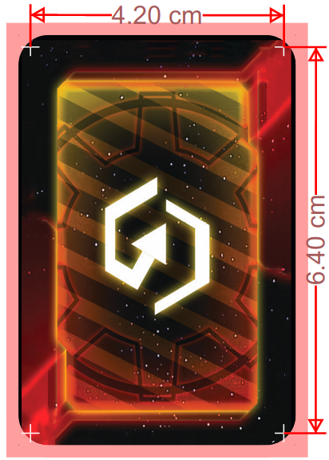

Now check whether the backs correspond to the fronts correctly. The image below shows the first two pages side by side; if, in a given row, the top-left card of the first page is the front of the top-right card on the same row of the second page, the process was correct.

  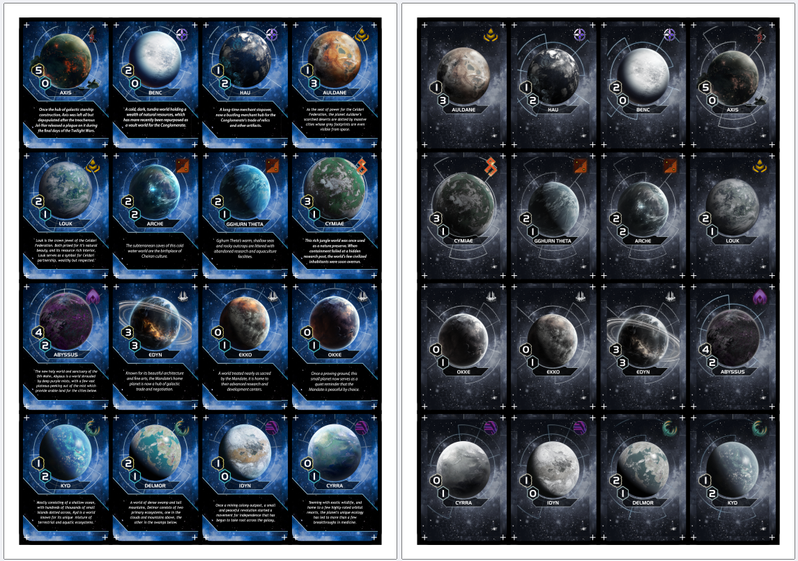

How should you rotate the images? The example below shows what you should **NOT** do. Printing this way will result in the backs being upside down. In particular, if the images are horizontal, the front should have its bottom on the left, while the top should have its bottom on the right, **opposite to each other**.

  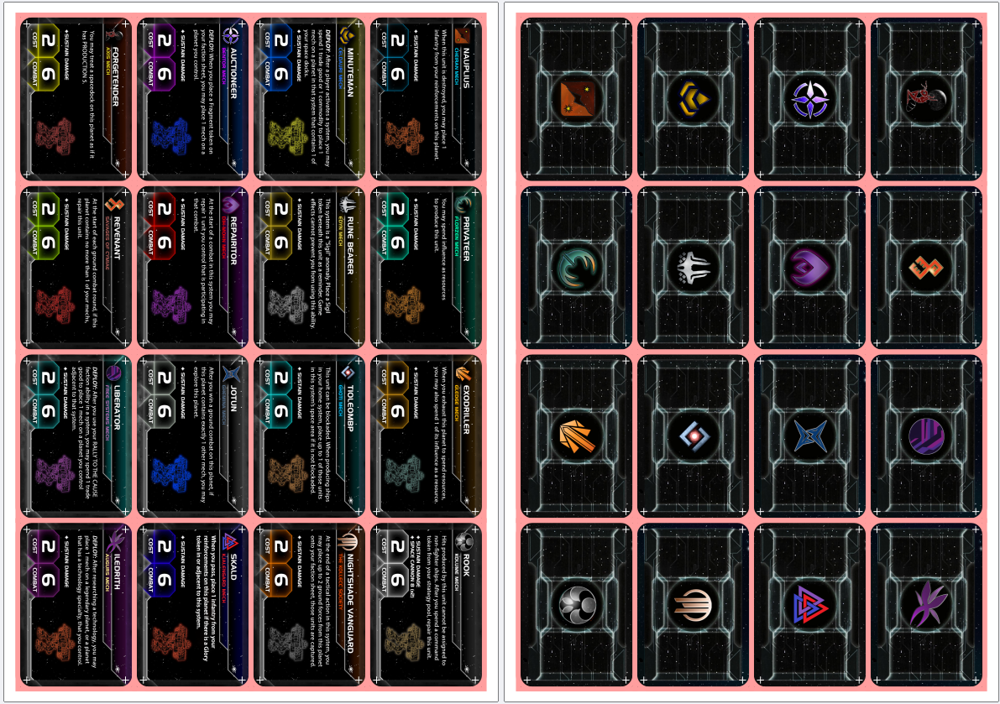

Now you're ready to print and cut your layouts. Jump to the [printing section](#printing) if you don't need the hexagon tiles and tokens.

### Step 4: Building the Hexagon layout
The hexagons need to be on thick cardboard, so my solution was to print the front and back on normal paper and then glue them onto cardboard. Therefore, the front and back are no longer in the same file.

To create the hexagon templates, I used a website called [Dextrous](https://www.dextrous.com.au/). It has some premium features, but I didn't need them. I'll refer to that website in the next section. You need to create an account to get started.

#### 4.1 Create the Layout
Go to `Layouts > new layout > start from empty layout > press on the exagon and scroll down selecting an exagon`. I chose "Hex 3.75 x 3.25 (95.3x82.6mm)" as a starting point, but it shouldn't make a difference. You should now see a hexagon on your screen.

  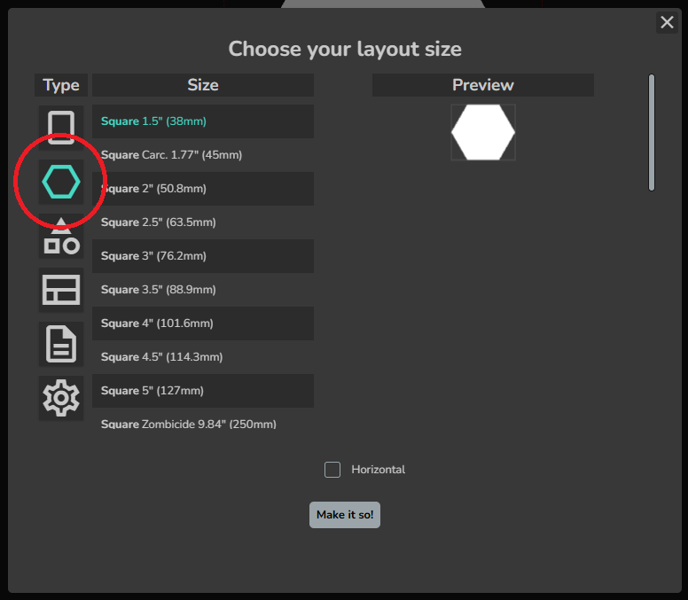
  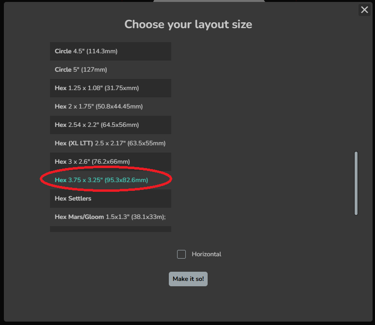

The hexagons in Twilight Imperium are regular hexagons (all sides have the same length) with a side length of ***5.8cm***. This means that if you inscribe such a hexagon in a square, you get a shape with a height of 10.046cm (you can approximate this to 10.05cm) and a width of 11.6cm. Let's enter these measurements in the app: in the left panel, press on positioning and scroll down until you see the measurements in pixels (px). Change the unit of measurement from "px" to "cm" and enter the measurements shown above. You should now have a regular hexagon of the correct size.

  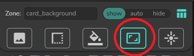
  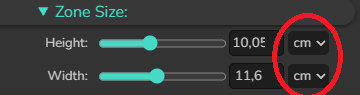

Now you need to position an image correctly. `press on image (1) > look down and press the create a folder icon (2) to create a folder > open the folder > press the add image icon to add an image (3) > click on the image (4)` The image will now be floating in the center.

  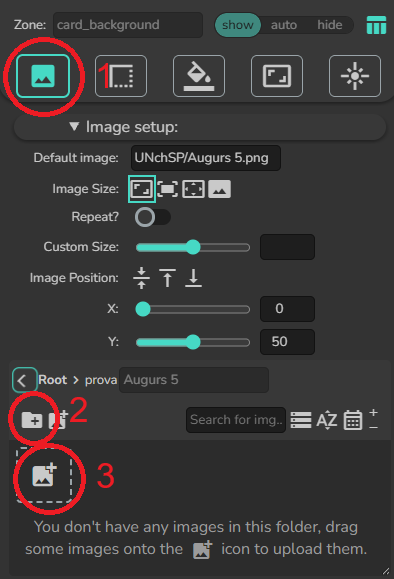

Now you'll need to adjust the *custom size* slider and the *Image position* sliders to make the **front** of the image fit the hexagon in the center. For the backs, you'll need to make another layout exactly the same as the first one, but adjust the image so that the hexagon shows the back of the tile.

It should look something like this:

  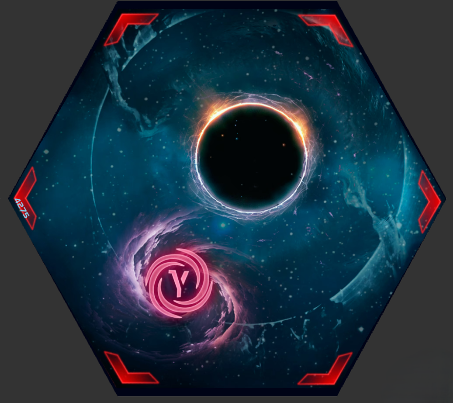

#### 4.2 Populate the layout

Now we need to populate the layout with the actual fronts of the system tiles.

First, you'll need to add the system images to the folder you've created. Go to `Home > Images > select the folder > upload everything`.

To fill the layout, you need a project: `Home > Create a new peoject > create a new component > link the exagon layout you've created before`. You should already have one hexagon filled. Now `press on the plus icon to spawn new exagons`. From the table below, change the image for each hexagon until you have all the system tiles.

  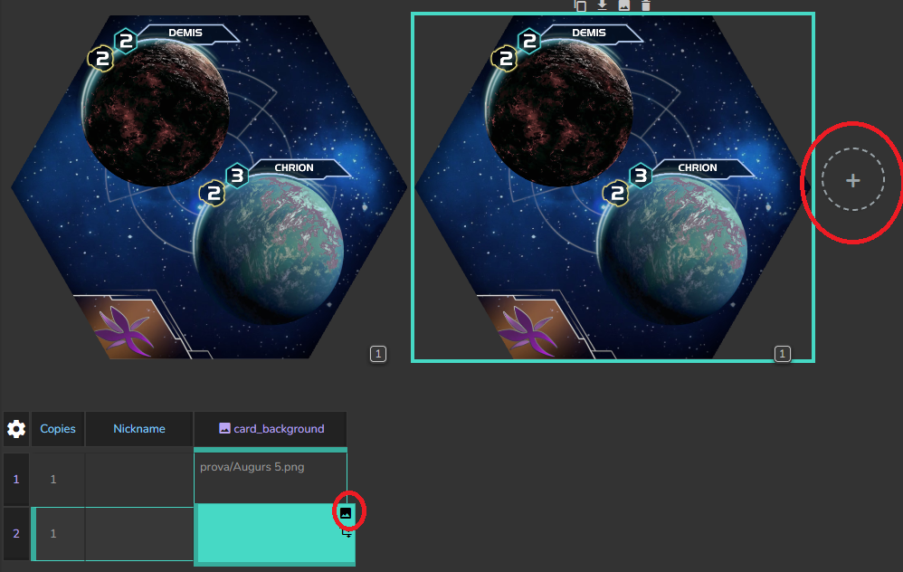

#### 4.3 Export the Layout

From the previous screen, press export and you'll see an export screen. In *Page setup*, leave everything as default and press export. Now `press Export > PDF - Chrome printer > be sure to follow the direction that the pop-up will give you > save as PDF`.

Now you have a printable PDF. Of course, check the actual dimensions with a virtual ruler before printing, as you did in [a previous step](#33-inspecting-the-pdf).

### Step 5: Building the tokens Layout

I didn't bother printing every single faction-specific command and control token, it would be tedious and also expensive. I printed only the special tokens. To print them you'll need to build new layouts, most of them will be simply circles so you can use the circle preset.

Circle token dimensions are either 3.1cm or 1.8cm in diameter.

Dimensions for the commodities increase tokens are in the image below

  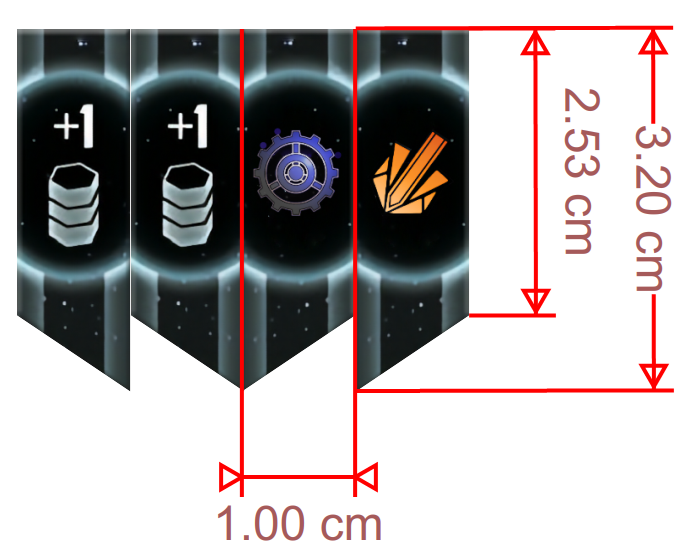

## Printing and cutting

Here I will explain how to print and cut the printable PDF files obtained earlier. If you don't have printable PDFs, you skipped too much; look [here](#obtaining-printable-files).

### How can I print them? Which materials should I use?

Printing the files at home is not ideal if you don't have a professional printer. I went to a professional print shop, where I was able to ask for advice about the materials.

For the **tokens** and **system tiles**, we chose 80g/m² glossy, scratch-resistant paper. I glued them onto 1cm thick cardboard that I bought on Amazon. I needed 15 A4 sheets to create all the tiles.

For the **cards** and **faction sheets**, I used 250g/m² paper. Paper with the same weight can have different levels of elasticity, so I recommend testing it against original faction sheets and cards to select the best one available. Even the same type can have different characteristics depending on the batch, so be careful and ask a professional. A good way to start is by checking whether the height of the paper, when placed face down on a table, is exactly the same as the height of an original card.

### Printing the Components

When printing, use 100% scale and real-world measurements; do not press "fit to page". Getting one setting wrong will cause the backs and fronts to be misaligned.

Pay attention to the colors: every printer prints differently, so adjust the colors to match the references. I had to reduce the intensity of all colors by 20% and the red by 30% to achieve an acceptable result.

### Cutting the components

#### Tools Needed

- Angle cutter
- Big scissors
- Cutting Mat
- Glue
- Guillotine paper cutter
- Hobby Knife
- Rulers

#### Cutting
- Cut the cards using the guillotine. I do not advise using one of those paper cutters with a slider (shown below under the "X"), as they tend to catch and tear the paper. A guillotine may seem less precise, but after a couple of minutes, cutting accurately will become easy and much faster.

  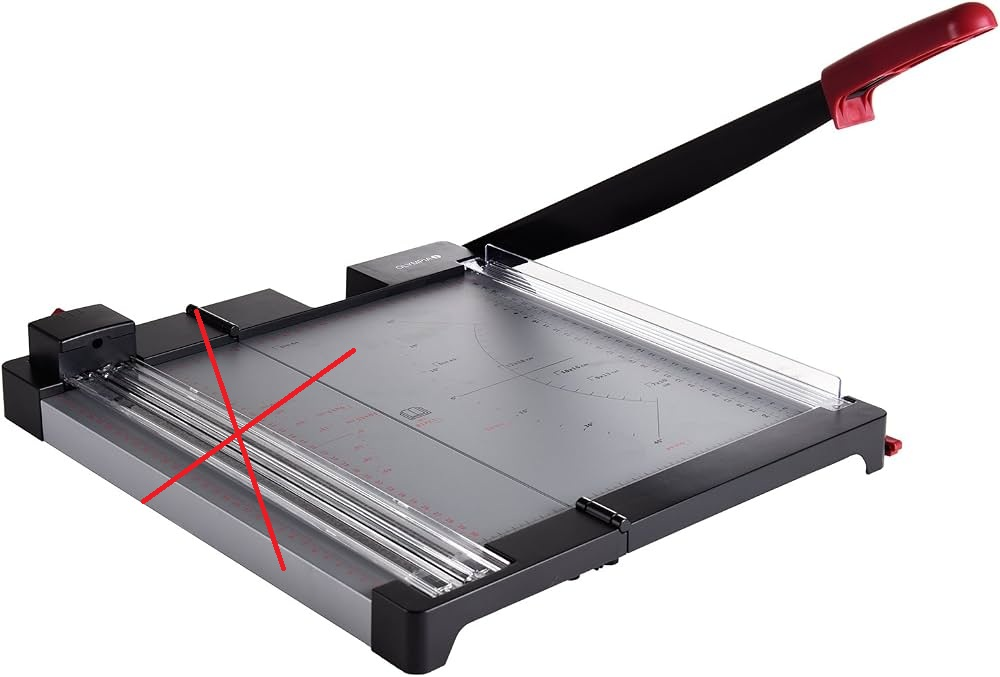

You need to follow the guides on the angles printed on the cards. Everything outside the area defined by the crosses will be discarded; that is the bleed. In the image, you should cut along the dotted lines.

  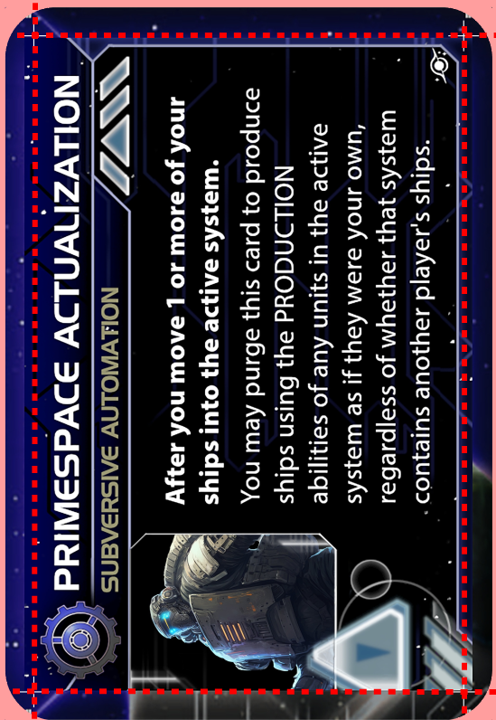

#### System tiles and tokens

For best results, roughly cut out the front of the system tiles and tokens and glue them directly onto the cardboard with regular glue. After it dries, cut the cardboard accurately with scissors, and you have the front.

For the backs, roughly cut out the paper and glue it to the back of the corresponding piece of cardboard. After it dries, turn the piece around and trim the edges with a hobby knife.

#### Refining the angles

To cut the angles, you'll need an angle cutter. I bought mine from Amazon; it looks something like this:

  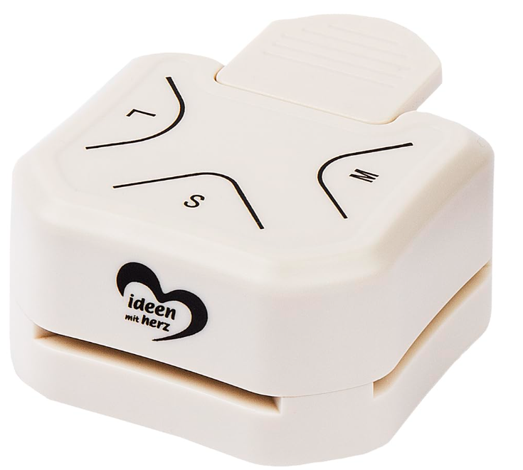

I wasn't able to determine the exact radius of the cards' angles. I cut my cards with a radius of *3mm* (as in the picture, the printed card is on the bottom), which is a little too big. If you're able to figure out the exact radius, contact me and I'll edit this page.

  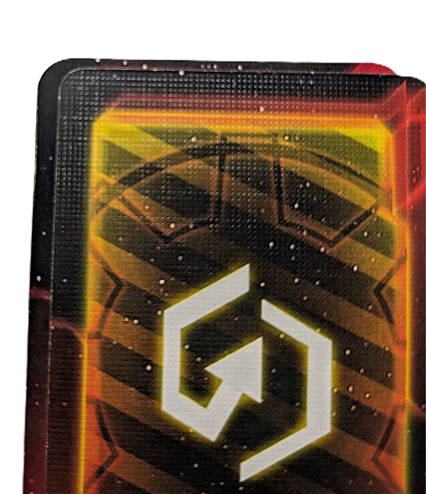

#### Results

It is practically impossible to match the exact colors of the original cards, so a good strategy for hiding the differences is to use sleeves. Twilight Imperium cards use 43 $\times$ 65mm sleeves (the cards are smaller, but this is the size that fits best). I wasn't able to find non-transparent sleeves, so I settled for the standard sapphire ones, which fit well enough and hide some defects.

Comparison between original and printed cards (the originals are the four on the left).

  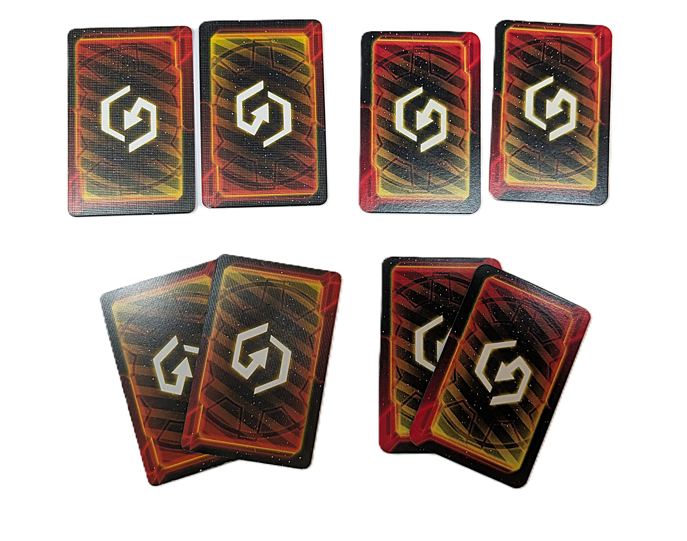

The printed cards do not have a linen texture, so they catch the light differently from the originals, but they otherwise have the same flexibility and are virtually indistinguishable from them by touch with the sleeves on.

  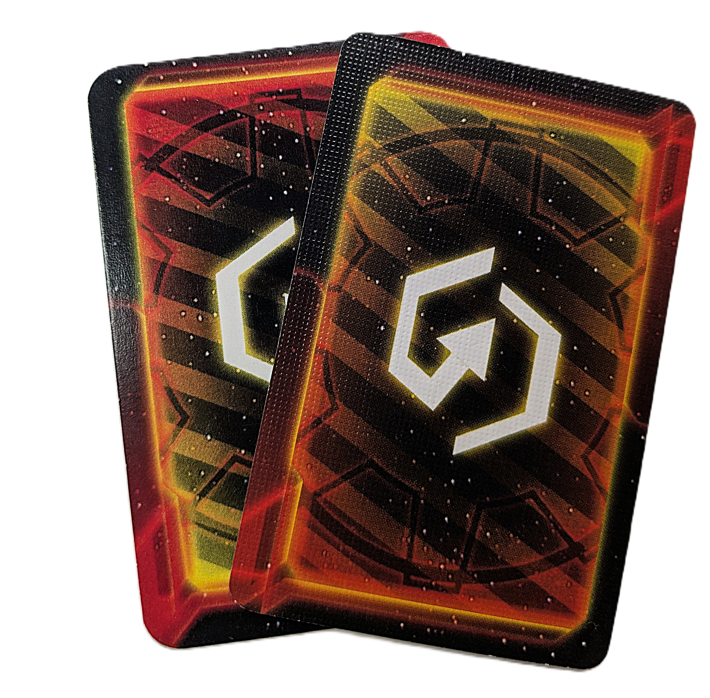

The system tiles are also smoother than the originals, but using *1mm* thick cardboard makes them the exact same size as the original tiles.

  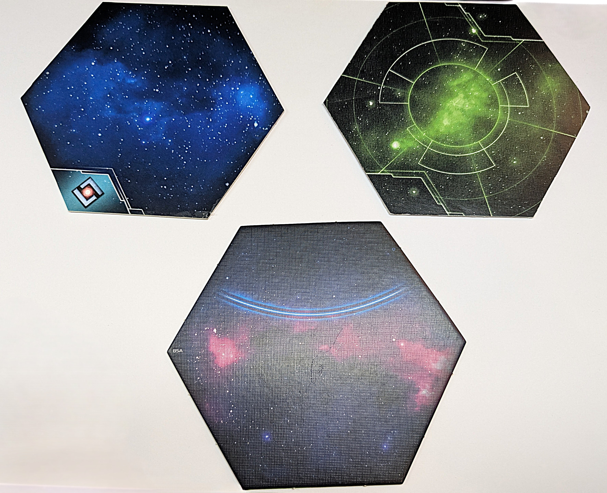

## Cover and box

**/////////// Section not yet completed ///////////**

I planned to build a nice box to hold all the game components. I wanted the box to be stackable on top of the "Prophecy of Kings" and "Thunder's Edge" boxes, and I needed it to fit on my shelves (the expansion boxes have a base of 30 $\times$ 30cm). I decided to buy an empty box from a board game with the measurements I needed; this way, I was sure to get a quality box. I found the empty box of a game called "[Inferno](https://boardgamegeek.com/boardgame/393165/inferno)" cheaply on Vinted. The game is 30 $\times$ 30 $\times$ 8cm, so it was perfect for my needs.

To check the size of a board game box and determine whether it fits your needs, I suggest you `go on [BGG](https://boardgamegeek.com) > find the game you need to check > versions > The version you need to check > and look at "dimensions"`. Here is an [example](https://boardgamegeek.com/boardgameversion/365218/english-edition).

I was able to generate some images with AI and glue them to the top, bottom, and sides of the box I bought. These images are in the [dedicated folder](assets/Box/RawImages/).

I suggest printing the images with an extra 0.5cm on all sides. The printable PDF files are provided [in the dedicated folder](assets/Box/Scaled/); it is designed to work with a box measuring 30 $\times$ 30 $\times$ 8cm.

/////**[ADD IMAGES OF the FINISHED BOX HERE]** /////

## 3D printed insert

**/////////// Section under construction ///////////**

I plan to commission a 3D-printed insert for the components, mostly for the system tiles.

**[Insert Images here]**

## Time and money spent on this project

**/////////// Section not yet completed ///////////**

I spent around 6 hours preparing the files (keep in mind that I didn't have a guide, so I believe you can do this step in a maximum of 3 hours), but the greatest amount of time was spent cutting the cards and system tiles. It took around 20 hours to turn the printed paper into finished components, so keep that in mind if you want to tackle this project.

The amount I spent on each component is listed below. These are Italian prices from September 2026, so they may differ from the prices of the materials available to you:

- Tools: I had most of the equipment and borrowed the paper cutter. The only thing I bought was the angle cutter for *7€*.
- Printing cost: *50€*
- Cardboard cost: *10€* (for 20 sheets)
- Box cost: *5€*
- Sleeves cost: TBD
- 3D-printed insert: TBD

Total: TBD
